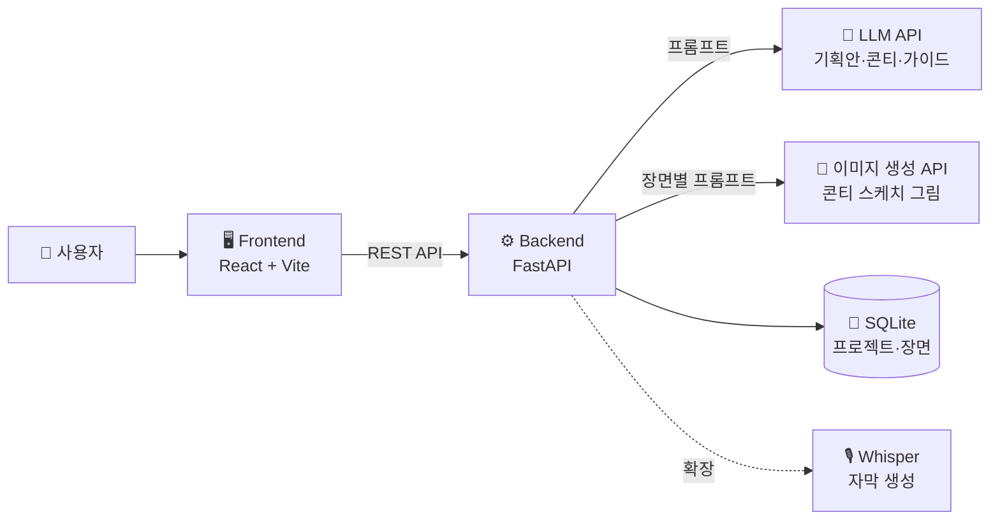

# 🎬 AI 숏폼·롱폼 영상 제작 도우미 (가제)

> **기획부터 콘티, 촬영 가이드, 편집 가이드까지** — 생성형 AI가 영상 제작의 전 과정을 안내하는 웹 서비스

동양미래대학교 컴퓨터소프트웨어공학과 「인공지능프로젝트」 개별 프로젝트

<br>

## 📌 프로젝트 개요

### 배경 및 문제
- 릴스·숏츠 같은 숏폼 시대가 되면서 누구나 영상을 만들고 싶어 하지만, **기획·콘티·촬영·편집**에는 전문 지식이 필요해 진입 장벽이 높습니다.
- 숏폼과 롱폼은 **화면 비율, 도입부 훅, 호흡** 등 구성 문법이 달라 초보자가 형식에 맞게 기획하기 어렵습니다.
- 기존 도구는 기획·콘티·편집이 각각 분리되어 있어 **제작 흐름이 끊깁니다.**

### 목적
- 생성형 AI로 **디테일한 콘티 + 콘티 이해를 돕는 그림 + 카메라 구도 + 편집 가이드**를 하나의 흐름으로 제공합니다.
- 영상 제작이 처음인 사람도 쉽게 숏폼·롱폼 영상을 기획하고 제작할 수 있도록 돕습니다.

### 예상 사용자
| 구분 | 사용자 |
|---|---|
| 📱 숏폼 | 릴스·숏츠를 시작하려는 초보 크리에이터, 가게·상품을 홍보하려는 소상공인 |
| 🎥 롱폼 | 브이로거, 강의·인터뷰 영상 제작자 |

<br>

## 🔄 서비스 흐름

```
① 기획  →  ② 콘티 (그림 포함)  →  ③ 촬영 가이드  →  ④ 촬영 (사용자)  →  ⑤ 편집 가이드
```

콘티의 **장면 번호**가 촬영 가이드와 편집 가이드까지 그대로 이어져, 모든 단계가 하나로 연결됩니다.

<br>

## ✨ 주요 기능

| 기능 | 설명 | 생성형 AI 역할 |
|---|---|---|
| ① AI 기획안 생성 | 주제와 형식(숏폼/롱폼)을 입력하면 아이디어와 전체 구성 제안 | LLM이 형식별 구성 규칙을 반영해 기획안 3개 작성 |
| ② AI 콘티 생성 | 컷별 장면 내용, 샷 크기, 앵글, 카메라 무빙, 대사, 시간을 표로 제공 | LLM이 기획안을 컷 단위로 분할·구조화 (JSON) |
| ③ 콘티 그림 생성 | 컷마다 스케치 콘티 그림 제공 | 이미지 생성 AI가 장면 + 구도 + 인물 설정을 조합해 생성 |
| ④ AI 촬영 가이드 | 장면별 구도 이유와 폰 촬영 방법을 체크리스트로 제공 | LLM이 사용자 촬영 환경에 맞춘 안내 생성 |
| ⑤ AI 편집 가이드 | 컷 순서·길이, 전환, 자막 문구·위치, 안전 영역 안내 | LLM이 콘티를 기준으로 편집 방향 설계 |
| ⑥ 인기 포맷 TOP 3 | 메인 화면에서 유행하는 영상 형식 소개 | LLM이 포맷 특징과 예시 구성을 요약 |

<br>

## 🏗️ 시스템 구조



| 구성 | 역할 |
|---|---|
| **Frontend** (React + Vite) | 단계별 화면, 입력 폼, 콘티 카드 UI, 장면 데이터 상태 관리 |
| **Backend** (FastAPI) | REST API, 숏폼/롱폼 규칙 기반 프롬프트 조립, AI 응답(JSON) 검증, 데이터 저장 |
| **LLM API** | 기획안·콘티·촬영 가이드·편집 가이드 생성 |
| **이미지 생성 API** | 컷별 스케치 콘티 그림 생성 |
| **Whisper** (확장) | 촬영본 음성 인식 → SRT 자막 파일 생성 |

### API 구성 (예정)

| 기능 | Endpoint | 사용 AI |
|---|---|---|
| 기획안 생성 | `POST /api/plan` | LLM |
| 콘티 생성 | `POST /api/storyboard` | LLM |
| 콘티 그림 생성 | `POST /api/storyboard/image` | 이미지 생성 AI |
| 촬영 가이드 | `POST /api/shooting-guide` | LLM |
| 편집 가이드 | `POST /api/edit-guide` | LLM |
| 인기 포맷 | `GET /api/trends` | LLM |
| 자막 파일 (확장) | `POST /api/subtitle` | Whisper |

### 핵심 데이터 구조 — 장면 (Scene)

```json
{
  "scene_no": 1,
  "description": "주인공이 알람을 끄며 일어난다",
  "shot_size": "클로즈업",
  "angle": "하이앵글",
  "camera_move": "고정",
  "dialogue": "오늘 하루 시작!",
  "duration": 2,
  "shooting_tip": "폰을 눈높이보다 살짝 위에 고정",
  "image_url": "/images/scene1.png"
}
```

<br>

## 🤖 AI 활용방안

생성형 AI가 **기획 → 콘티 → 구도 → 편집** 전 과정에서 초보 크리에이터의 **영상 디렉터** 역할을 합니다.

| 단계 | 사용 AI | AI가 하는 일 |
|---|---|---|
| 기획 | LLM | 주제·대상·분위기를 분석해 형식 규칙에 맞는 기획안 제안 |
| 디테일 콘티 | LLM | 컷 단위로 장면 내용·샷 크기·앵글·카메라 무빙·대사·시간 구조화 |
| 콘티 이미지 | 이미지 생성 AI | 장면 설명 + 구도 + 인물 설정을 조합해 스케치 그림 생성 |
| 구도·촬영 | LLM | 구도를 고른 이유와 폰 촬영 방법 (높이, 거리, 거치, 조명) 안내 |
| 편집 | LLM | 컷 순서·길이, 전환 효과, 자막 문구·위치, 세로 화면 안전 영역 안내 |
| 자막 (확장) | Whisper | 촬영본 음성 인식으로 SRT 자막 파일 생성 |

### 숏폼 vs 롱폼 구성 규칙

| 구분 | 숏폼 | 롱폼 |
|---|---|---|
| 화면 비율 | 9:16 세로 | 16:9 가로 |
| 길이 | 15–60초 권장 | 5–20분 |
| 도입부 | 첫 1–3초 강한 훅 | 인트로·예고로 흥미 유발 |
| 구성 | 빠른 컷 전환, 반복 재생 유도 | 도입–전개–마무리 챕터 구성 |

### 콘티 이미지 프롬프트 구성
```
그림체 (연필 스케치 + 연한 수채) + 구도 (샷 크기·앵글) + 인물 설정 + 장면 내용 + 화면 비율
```
- 인물 설정(외모·옷차림)을 모든 컷에 동일하게 적용해 일관성 유지
- 그림 속에는 글자를 넣지 않고, 컷 번호·대사는 화면 UI로 표시

### AI 결과 품질 관리
- 시스템 프롬프트에 형식별 규칙과 JSON 출력 형식 명시
- Few-shot 예시로 결과 형식 안정화
- 백엔드에서 JSON 검증 후 실패 시 자동 재요청
- 특정 컷만 수정할 때 나머지 콘티는 유지

<br>

## 🛠️ 기술 스택

| 구분 | 기술 |
|---|---|
| Frontend | React, Vite |
| Backend | Python, FastAPI |
| Database | SQLite |
| AI | LLM API, 이미지 생성 API |
| 확장 | Whisper (로컬 음성 인식) |

<br>

## 📁 프로젝트 구조 (예정)

```
.
├── frontend/              # React + Vite
│   └── src/
│       ├── pages/         # 홈, 기획, 콘티, 촬영 가이드, 편집 가이드
│       └── components/    # 콘티 카드, 진행 바 등
├── backend/               # FastAPI
│   └── app/
│       ├── routers/       # API 엔드포인트
│       ├── prompts/       # 숏폼/롱폼 프롬프트 템플릿
│       └── schemas/       # 장면 데이터 구조 (Pydantic)
└── README.md
```

<br>

## 📅 개발 일정

| 주차 | 기간 | 개발 목표 |
|---|---|---|
| 기획 | 9/29 – 10/21 | 주제 선정, 요구사항·기능 정의, 계획서 보완 |
| W1 | 10/22 – 10/28 | 개발 환경 구축, API 연동 테스트 |
| W2 | 10/29 – 11/4 | AI 기획안 생성 |
| W3 | 11/5 – 11/11 | AI 콘티 생성 (텍스트·구도) |
| W4 | 11/12 – 11/16 | 콘티 그림 생성, MVP 완성, 발표 준비 |
| 🎤 | 11/17 | 프로젝트 발표 |
| W5 | 11/18 – 11/24 | 롱폼 지원, 촬영 가이드 |
| W6 | 11/25 – 12/1 | 편집 가이드, 인기 포맷, 완성도 향상 |
| 🏆 | 12/2 | 경진대회 |

<br>

## 🚀 실행 방법 (예정)

```bash
# Backend
cd backend
pip install -r requirements.txt
uvicorn app.main:app --reload

# Frontend
cd frontend
npm install
npm run dev
```

> ⚠️ API 키는 `backend/.env` 파일에 저장하고, `.env`는 `.gitignore`에 추가해 GitHub에 올리지 않습니다.

<br>

## 📝 범위 및 참고 사항
- 완성 영상 렌더링(자동 편집 출력)은 비용·개발 부담으로 제외하고, 편집은 **가이드 형태**로 제공합니다.
- 숏폼은 전체 컷 그림을 생성하고, 롱폼은 핵심 장면 위주로 생성해 비용을 관리합니다.
- 주제, 기능, 일정은 개발 과정에서 변경될 수 있습니다.
